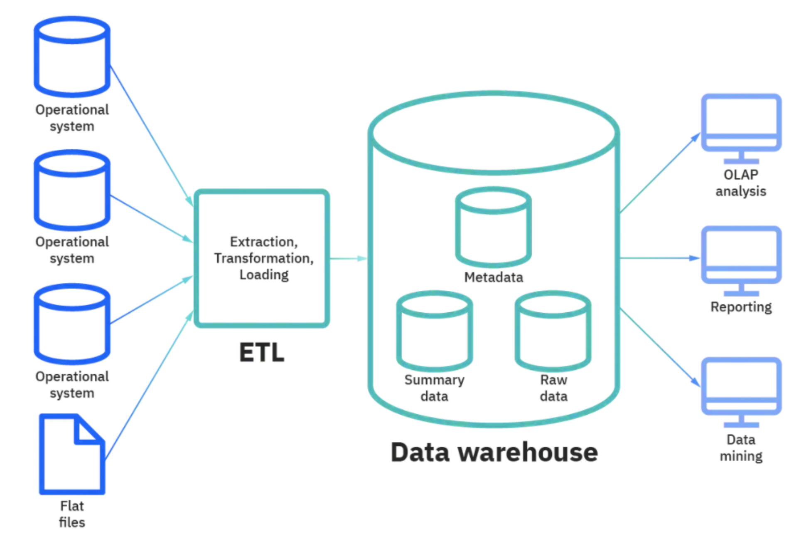
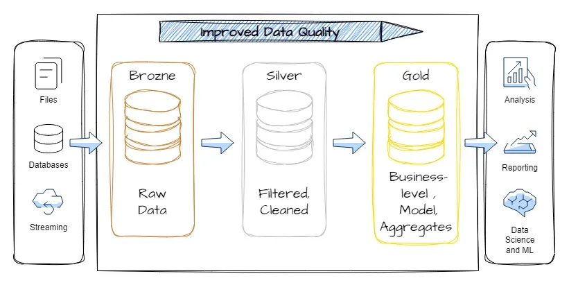
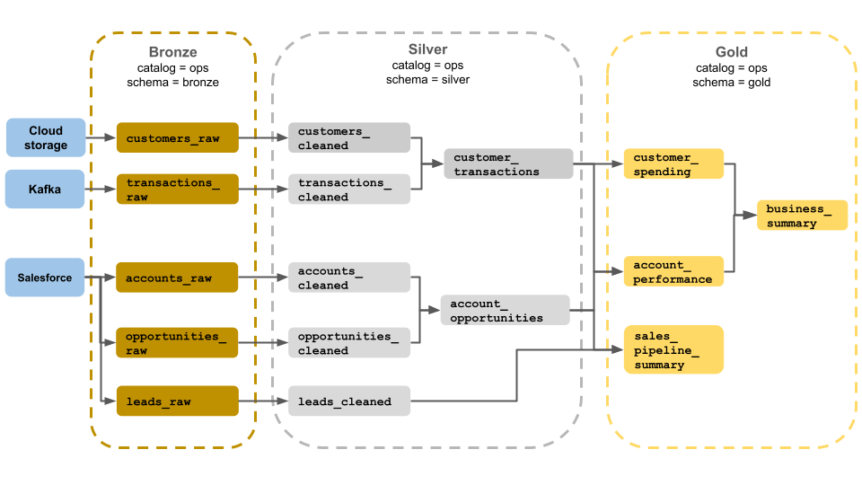

# MSIS-2419 — Business Intelligence and Data Warehousing

**Santa Clara University · Leavey School of Business**
**Information Systems & Analytics — Graduate Program**

    
[](https://duckdb.org) [](https://marimo.io) [](https://www.python.org) [](https://www.tableau.com)
  

| | |
|---|---|
| **Format** | 10 weeks · 20 sessions (2 per week, 100 minutes each) · a 30-minute in-class lab in every session |
| **Credit** | 4 units |
| **Quarter** | Winter 2027 (January–March) · [dates & hours](course_information/class_meeting_dates_hours.md) |
| **Instructor** | [Dr. Mahmoud Parsian](https://www.scu.edu/business/isa/faculty/parsian/) |
| **Teaching assistant** | to be announced |
| **Prerequisites** | ISBA 2401 (Data Analytics with Python) and ISBA 2402 (Database Management Systems — Fundamentals of SQL) |
| **Primary tools** | [DuckDB](https://duckdb.org) · [Marimo](https://marimo.io) notebooks · Python · [Tableau](https://www.tableau.com) |

---

## Contents

1. [Course Description](#course-description)
2. [Course Schedule](#course-schedule)
3. [Grading at a Glance](#grading-at-a-glance)
4. [Getting Started](#getting-started)
5. [Repository Structure](#repository-structure)
6. [Course Policies & Information](#course-policies--information)
7. [Background: Data Warehousing in One Page](#background-data-warehousing-in-one-page)

---

## Course Description

From the [course catalog](https://www.scu.edu/business/isa/academics/courses/):

*Introduces the business, technology, and managerial issues related to BI and DW solutions. Students will acquire practical skills in collecting business requirements, planning, defining, designing and developing a BI solution. Emphasis is placed on learning how to derive business value from BI and DW solutions. Hands-on experience will be obtained using a variety of BI tools.*

**What you will build.** Starting from SQL for analytics, you design star schemas and OLAP queries, then build a
**Medallion** warehouse (Bronze → Silver → Gold) for one running case, a pizza shop: raw files with real problems,
a second sales channel to conform, monthly incremental loads, a Gold star schema, KPIs, dashboards and a final data story.
Every session ends with a **30-minute in-class lab**. In teams, you also build and present your own data warehouse
([project](syllabus/PROJECT/DW_Project_Guidelines.md)).

**Why DuckDB and Marimo?** DuckDB is an analytical database that runs inside Python with no server to install, so class time
goes to SQL and design, not setup. Every notebook in the course (lectures and labs) is a [Marimo](https://marimo.io) notebook:
a plain `.py` file you open with `marimo edit`.

```python
import duckdb
duckdb.sql("SELECT 'Hello, data warehouse!' AS greeting").show()
```

More: [Course information & learning outcomes](course_information/course_info_and_desc.md).

---

## Course Schedule

Full schedule with both sessions' topics: [Syllabus](syllabus/README.md) · Start with [Week 0: outline & software setup](syllabus/week00-outline-and-TOC/).

| Week | Module | Session 1 lab | Session 2 lab |
|:---:|---|---|---|
| | **A · SQL analytics review** | | |
| **1** | [Foundations of SQL for Analytics](syllabus/week01-Foundations-SQL-for-Analytics/) | From Business Questions to SQL (Insurance) | GROUP BY, HAVING and CASE on Sales Data |
| **2** | [SQL Analytical Thinking & Exploratory Data Analysis](syllabus/week02-SQL-Analytical-Thinking-and-EDA/) | Window Functions: Keep the Rows, Add the Insight | Exploratory Data Analysis (EDA) with SQL |
| | **B · Classic data warehousing** | | |
| **3** | [Classic Data Warehousing & ETL](syllabus/week03-Classic-Data-Warehousing/) | From Operational Tables to Your First Star Schema | ETL: Extract, Clean and Load Messy Sales Data |
| **4** | [Star Schema in Depth & OLAP](syllabus/week04-Star-Schema-and-OLAP/) | Slowly Changing Dimensions: Keeping History Right | OLAP on a Star Schema: Roll-up, Drill-down, Slice, Dice, Pivot, CUBE … and Tableau |
| | **C · Medallion architecture** | | |
| **5** | [Medallion Architecture: Introduction](syllabus/week05-Medallion-Architecture-Introduction/) | Your First Medallion Pipeline: Bronze → Silver → Gold | Medallion as a Lakehouse: Layers as Files |
| **6** | [Bronze in Depth & Silver Cleaning](syllabus/week06-Bronze-and-Silver-Cleaning/) | Bronze in Depth: Landing Real Files, Batch by Batch | Silver Cleaning: From Bronze to Trusted Order Lines |
| **7** | [Silver: Conforming & Integrating Sources](syllabus/week07-Silver-Layer-Cleaning-and-Conforming/) | Conforming a Second Source: the Delivery App | Integrating Two Sources into One Trusted Silver Table |
| **8** | [Gold Layer & Star Schema](syllabus/week08-Gold-Layer-Star-Schema/) | Gold: A Star Schema for the Pizza Shop | Gold KPIs and Data Marts (and a Tableau Dashboard) |
| | **D · Wrap-up** | | |
| **9** | [End-to-End Pipeline, Incremental Processing & Project Workshop](syllabus/week09-End-to-End-Pipeline-and-Project-Workshop/) | An Incremental Pipeline: New Files Arrive Every Month | Late Data, Corrections, and Proving the Pipeline Right |
| **10** | [Final Project & Data Storytelling](syllabus/week10-Final-Project-Data-Storytelling/) | From Gold to a Data Story: KPIs, Like-for-Like, Drivers | Dashboard and One-Slide Story |

Optional: [Bonus — LLM + SQL integration](syllabus/bonus-LLM-SQL-Integration/).

**A typical session (100 minutes):**

| Part | Activity |
|---|---|
| First ~70 minutes | Lecture and live demo (slides + Marimo notebooks) |
| Last 30 minutes | In-class lab: released at the start of the session in the week's `labs/` folder (a lab sheet + a Marimo notebook) |

---

## Grading at a Glance

| Component | % |
|---|---:|
| **In-class labs** — 20 labs (2 per week), lowest 2 dropped | 40 |
| **Project** — documentation & EDA 10 · implementation 10 · presentation 10 | 30 |
| **Midterm exam** — closed book, lock-down browser | 10 |
| **Final exam** — closed book, lock-down browser | 20 |
| **Bonus** — exceptional work | 2 |

Full policy: [Grading and class conduct](course_information/grading_and_class_conduct.md) · [Academic integrity](course_information/academic_integrity.md).

---

## Getting Started

1. Install the tools ([details](course_information/required_software.md)):
   ```bash
   pip install duckdb pandas matplotlib seaborn marimo
   ```
2. Clone this repository, then check your setup with the week 0 demo notebook:
   ```bash
   cd syllabus/week00-outline-and-TOC
   marimo edit week00_3_demo_notebook.py
   ```
3. Each week, open the week's folder (`syllabus/weekNN-…/`): its `README.md` lists the slides, notebooks and labs.

---

## Repository Structure

```text
.
├── README.md                    this page
├── course_information/          course description, dates, grading, policies, exams, software, books
├── syllabus/
│   ├── README.md                the weekly schedule
│   ├── week00-outline-and-TOC/  course outline and software setup
│   ├── week01-… … week10-…/     one folder per week: README, slides, Marimo notebooks, data, labs/
│   ├── bonus-LLM-SQL-Integration/
│   └── PROJECT/                 project guidelines
└── resources/                   extra reading: DuckDB, ETL, OLAP, SQL references
```

---

## Course Policies & Information

All pages are in [`course_information/`](course_information/).

| Folder | Description |
|---|---|
| 📘 [Course information & description](course_information/course_info_and_desc.md) | Catalog entry, units, prerequisites, learning outcomes and how the course runs |
| 🗓️ [Class meeting dates & hours](course_information/class_meeting_dates_hours.md) | The one page for the quarter's dates: classes, midterm, presentations, final (TBD until SCU publishes the schedule) |
| 📊 [Grading and class conduct](course_information/grading_and_class_conduct.md) | Grade breakdown (labs 40% with the lowest 2 dropped, project 30%, midterm, final, bonus) and class policies |
| ⚖️ [Academic integrity](course_information/academic_integrity.md) | SCU's academic-integrity rules: what you submit must be your own work |
| ✅ [Prerequisites](course_information/prerequisite.md) | Catalog prerequisites and the SQL and Python you need to know |
| 🕐 [Office hours](course_information/office_hours.md) | How to ask questions: in class, office hours, Camino Discussions; teaching assistant |
| 📝 [Midterm exam](course_information/midterm_exam.md) | Date, format and rules of the midterm |
| 🎓 [Final exam](course_information/final_exam.md) | Date, format and rules of the final exam |
| 💻 [Required software](course_information/required_software.md) | DuckDB, Python 3.11+, Marimo, Tableau (setup steps in Week 0) |
| 📚 [Required books](course_information/required_books.md) | Textbooks and free online tutorials for data warehousing and the lakehouse |
| 🐍 [Python tutorials](course_information/python_tutorials.md) | Free Python guides and tutorials |
| 🧮 [SQL tutorials](course_information/sql_tutorials.md) | Free SQL introductions and tutorials |
| ✍️ [SQL style guide](course_information/sql_style_guide.md) | How to format SQL in this course (keywords in capitals, layout) |
| 👤 [Instructor](course_information/instructor.md) | About the instructor, with contact links |
| 📖 [Mahmoud Parsian's published books](course_information/mahmoud_parsian_books.md) | The instructor's books on data algorithms and Spark |
| 📗 [Glossary](https://github.com/mahmoudparsian/big-data-mapreduce-course/blob/master/slides/glossary/README.md) | Terms from Big Data, MapReduce, Spark and data warehousing (external page) |

---

## Background: Data Warehousing in One Page

<details>
<summary>

## What is a Database? 

</summary>

>  the DATABASE helps to perform the **fundamental operation of business**:
> 
* keep customer records
* product records
* transactions, 
* patient profile records
* patient DNA samples,
* ...

</details>


<details>
<summary>

## What is a Data Warehouse?

</summary>

>  the DATA WAREHOUSE helps you to **analyze your business**.

</details>


<details>
<summary>

## What does a Data Warehouse look like?

</summary>

		Where do you store a petabyte of data for  
		business intelligence?  A  data warehouse, 
		that’s where. Data spans for 2+ years...
		
		At  its  core, a   Data  Warehouse  is  a 
		centralized, read-optimized system designed 
		specifically for querying, reporting,  and 
		analytics. It’s where  your business  data 
		goes  after it’s  been cleaned, structured,  
		and denormalized for performance. 
		
		Unlike operational databases that are built 
		for transactions —  fast  inserts,  updates, 
		deletes — a warehouse is built for OLAP (online 
		analytical processing): aggregations, joins, 
		historical trends, and slow-but-heavy queries.
		
</details>


<details>
<summary>

## What is Data Warehousing?

</summary>

		Data  warehousing (DW) is a technique 
		of gathering and  analyzing data from 
		many sources to get valuable business 
		insights. Typically, a data warehouse 
		integrates and analyzes business data 
		from many sources. 	
			
		The data  warehouse  is the  basis of 
		the business intelligence (BI) system, 
		which can analyze and report on data.

</details>


<details>
<summary>

## Skills you will develop: 

</summary>


		Derive insights from data by 
		building analytical, managerial 
		and baseline technical skills.

</details>

---
## Classic Data Warehousing



---

## Medallion Architecture Data Warehousing



---------

## Example Medallion Architecture



---

*MSIS-2419 · Department of Information Systems & Analytics · Santa Clara University · Instructor: [Dr. Mahmoud Parsian](https://www.scu.edu/business/isa/faculty/parsian/)*
