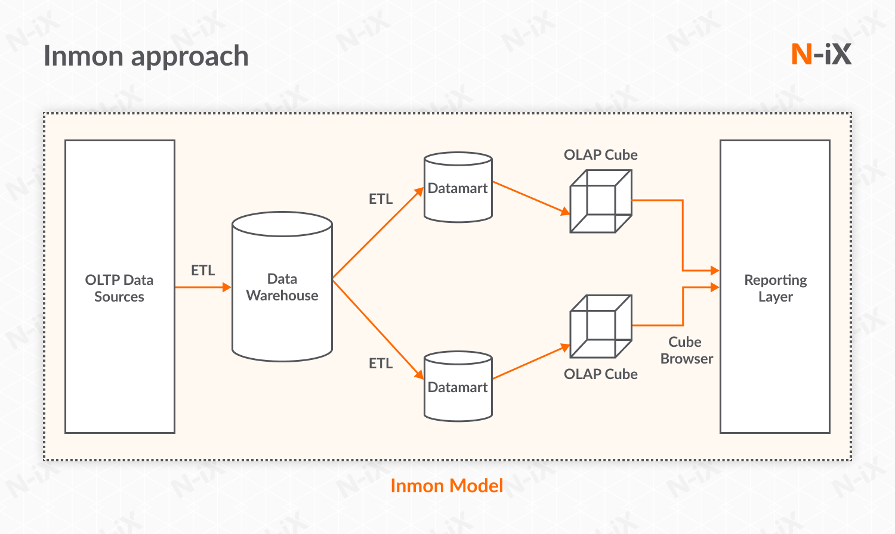
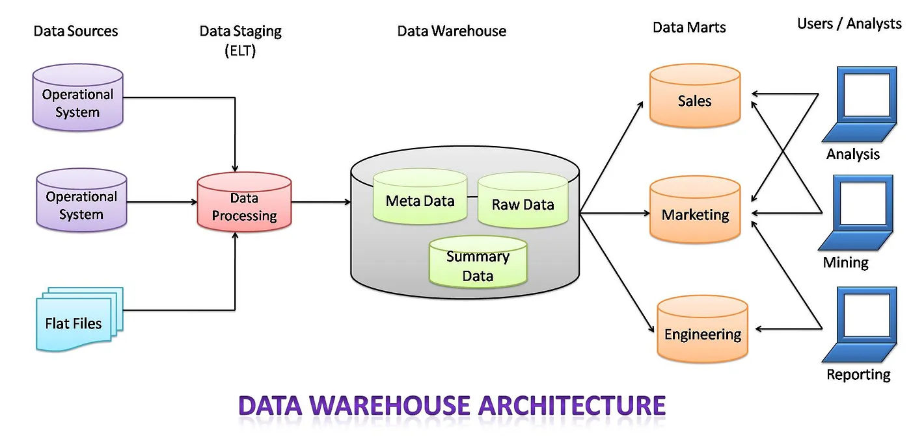

# Syllabus

**MSIS-2419 · Business Intelligence and Data Warehousing** · Winter 2027 (January–March)

10 weeks · 2 sessions per week (100 minutes each) · a **30-minute in-class lab in every session** (20 labs).
Labs are released in class (lab sheet + Marimo notebook in each week's `labs/` folder). Dates: [Class Meeting Dates & Hours](../course_information/class_meeting_dates_hours.md).

Start here: [Week 0 — Course outline & software setup](week00-outline-and-TOC/README.md)

## 📅 Weekly schedule

| Week | Session 1 · Lab | Session 2 · Lab |
|---|---|---|
| **A. SQL analytics review** | | |
| [**Week 1** Foundations of SQL for Analytics](week01-Foundations-SQL-for-Analytics/README.md) | Question → SQL → insight; filtering and aggregation on insurance data *Lab 1.1: From Business Questions to SQL (Insurance)* | GROUP BY in depth: multi-column groups, `HAVING`, `CASE`, top-N, percent of total *Lab 1.2: GROUP BY, HAVING and CASE on Sales Data* |
| [**Week 2** SQL Analytical Thinking & Exploratory Data Analysis](week02-SQL-Analytical-Thinking-and-EDA/README.md) | Analytical thinking + window functions *Lab 2.1: Window Functions: Keep the Rows, Add the Insight* | Exploratory data analysis with SQL *Lab 2.2: Exploratory Data Analysis (EDA) with SQL* |
| **B. Classic data warehousing** | | |
| [**Week 3** Classic Data Warehousing & ETL](week03-Classic-Data-Warehousing/README.md) | What a data warehouse is; OLTP vs OLAP; fact, dimension, grain *Lab 3.1: From Operational Tables to Your First Star Schema* | ETL / ELT for data warehousing *Lab 3.2: ETL: Extract, Clean and Load Messy Sales Data* |
| [**Week 4** Star Schema in Depth & OLAP](week04-Star-Schema-and-OLAP/README.md) | Star schema in depth: SCD, conformed dimensions, factless facts, data marts *Lab 4.1: Slowly Changing Dimensions: Keeping History Right* | OLAP: roll-up, drill-down, slice, dice, pivot; `ROLLUP`, `CUBE`, `GROUPING SETS`; first Tableau chart *Lab 4.2: OLAP on a Star Schema: Roll-up, Drill-down, Slice, Dice, Pivot, CUBE … and Tableau* |
| **C. Medallion architecture** | | |
| [**Week 5** Medallion Architecture: Introduction](week05-Medallion-Architecture-Introduction/README.md) | Why Medallion; Bronze → Silver → Gold with business rules *Lab 5.1: Your First Medallion Pipeline: Bronze → Silver → Gold* | Medallion as a lakehouse: files, Parquet, partitions *Lab 5.2: Medallion as a Lakehouse: Layers as Files* |
| [**Week 6** Bronze in Depth & Silver Cleaning](week06-Bronze-and-Silver-Cleaning/README.md) | Bronze in depth *Lab 6.1: Bronze in Depth: Landing Real Files, Batch by Batch* | Silver cleaning: data-quality dimensions, profiling, nulls, standardization, outliers, dedup, enrichment, validation *Lab 6.2: Silver Cleaning: From Bronze to Trusted Order Lines* |
| [**Week 7** Silver: Conforming & Integrating Sources](week07-Silver-Layer-Cleaning-and-Conforming/README.md) | Conformance: schema alignment, canonical codes, mapping tables, time zones *Lab 7.1: Conforming a Second Source: the Delivery App* | Integration: quarantine, source conflicts, `UNION ALL`, reconciliation, cross-source KPIs *Lab 7.2: Integrating Two Sources into One Trusted Silver Table* |
| [**Week 8** Gold Layer & Star Schema](week08-Gold-Layer-Star-Schema/README.md) | Gold modeling: business-first design, grain, dimensions, surrogate keys, validation *Lab 8.1: Gold: A Star Schema for the Pizza Shop* | KPIs that add up, data marts, Gold → Tableau *Lab 8.2: Gold KPIs and Data Marts (and a Tableau Dashboard)* |
| **D. Wrap-up** | | |
| [**Week 9** End-to-End Pipeline, Incremental Processing & Project Workshop](week09-End-to-End-Pipeline-and-Project-Workshop/README.md) | Pipelines over time: state, watermarks, idempotency, incremental Silver and Gold *Lab 9.1: An Incremental Pipeline: New Files Arrive Every Month* | Late data, partition rebuilds, corrections, validation · **project workshop** *Lab 9.2: Late Data, Corrections, and Proving the Pipeline Right* |
| [**Week 10** Final Project & Data Storytelling](week10-Final-Project-Data-Storytelling/README.md) | Why DW + Medallion, KPIs, storytelling *Lab 10.1: From Gold to a Data Story: KPIs, Like-for-Like, Drivers* | Honest dashboards, the one-slide story · **final project presentations** *Lab 10.2: Dashboard and One-Slide Story* |

**Optional:** [Bonus — LLM + SQL Integration](bonus-LLM-SQL-Integration/README.md) · **Project:** [Project guidelines](PROJECT/DW_Project_Guidelines.md) (presentations in week 10)

The midterm and final exams: see [Midterm](../course_information/midterm_exam.md) · [Final](../course_information/final_exam.md). Grading: [Grading and class conduct](../course_information/grading_and_class_conduct.md).

---

## Definition of a Data Warehousing

	     Bill Inmon, known as the "Father 
	     of Data Warehousing",  defines a 
	     data warehouse (DW) as a collection 
	     of data that is: 

| Data Warehouse feature    | Description  |
| ------------------------- | -------------|
| 1. **Subject-oriented**:  | Focuses on a specific area, such as sales, marketing, or distribution |
| 2. **Integrated**:        | Combines different data types from various sources |
| 3. **Non-volatile**:      | Stable and doesn't change once entered into the DW |
| 4. **Time-variant**:      | Analyzes changes over time, and typically contains multiple years of data |

	

