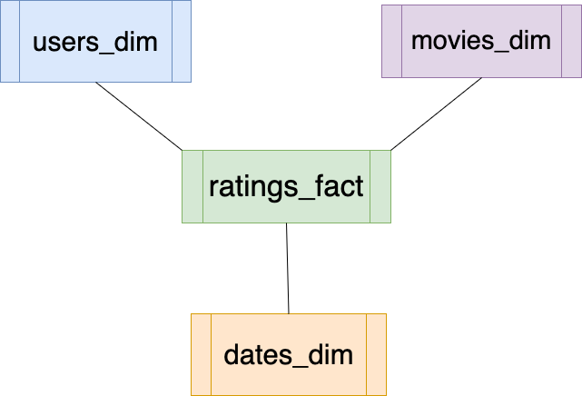

# Movies: Transactional DB → ETL → Star Schema → OLAP Queries (DuckDB)

A complete, realistic warehouse story in three steps:

```
CSV files ──step 1──▶ movies_db.duckdb ──step 2: ETL──▶ movies_dw.duckdb ──step 3──▶ 20 OLAP queries
             (OLTP: movies, users, ratings)      (star schema: 3 dimensions + 1 fact)
```

| Data | Rows |
|---|---|
| `IMDB_Movies_2000_2020.csv`: IMDB movies released 2000–2020 | 5,487 |
| `users.csv` | 100,000 |
| `ratings.csv`: one user rates one movie (1–10) on a day in 2020–2023 | 2,000,000 |

## ▶️ Run it (about 2 seconds)

```bash
pip install duckdb
python3 run_pipeline.py
```

[`run_pipeline.py`](run_pipeline.py) runs all three steps with the **Python** `duckdb` package.
Want to run the steps one by one?

```bash
duckdb movies_db.duckdb < step_1_build_transacational_db/build_transactional_db.sql   # step 1 (CLI)
python3 step_2_etl_to_star_schema/etl_duckdb.py movies_db.duckdb movies_dw.duckdb       # step 2
duckdb movies_dw.duckdb < step_3_OLAP_queries/OLAP_Queries_DuckDB.sql                    # step 3 (CLI)
```

> ⚠️ A `.duckdb` file written by a **newer** DuckDB can't be opened by an **older** one.
> If your `duckdb` CLI and your Python `duckdb` package have different versions
> (`duckdb --version` vs `python3 -c "import duckdb; print(duckdb.__version__)"`), use `run_pipeline.py`.

## Step 1: Transactional (OLTP) database

[`build_transactional_db.sql`](step_1_build_transacational_db/build_transactional_db.sql) loads the 3 CSV files into `movies`, `users`, `ratings`.
`ratings.movie_id` refers to the movie's **position in the movies file**, so step 1 adds `movie_id` from the row order.
(`generate_*_as_csv_file.py` are the scripts that generated the random users and ratings.)

## Step 2: ETL into a star schema



[`etl_duckdb.py`](step_2_etl_to_star_schema/etl_duckdb.py) attaches the source database read-only and builds:

| Table | Grain / content | Rows |
|---|---|---|
| `movies_dim` | one row per movie: `movie_id, movie_title, genre` (first genre), `all_genres, release_year, duration_minutes, country, director, imdb_avg_vote, imdb_votes` | 5,487 |
| `users_dim` | one row per user: `user_id, user_name` | 100,000 |
| `dates_dim` | one row per rating date: `date_id` (YYYYMMDD), `rating_date, year, quarter, month, month_name, day, day_name` | 1,461 |
| `ratings_fact` | **one row per rating**: `rating_id, movie_id, user_id, date_id, rating` | 2,000,000 |

It ends with **validation**: fact rows = source rows, `SUM(rating)` equal on both sides, and no orphan keys.
It exits with an error if any check fails.

Two transformation decisions worth discussing:
- `genre` in the source is a list (`"Comedy, Fantasy, Romance"`). The warehouse keeps the full list as `all_genres` and uses the **first** genre as `genre`, so each movie counts once in "per genre" analysis.
- Movie titles are **not unique** (e.g. two different films called *The Hole*), so queries group by `movie_id`, not just by title.

## Step 3: OLAP queries

[`OLAP_Queries_DuckDB.md`](step_3_OLAP_queries/OLAP_Queries_DuckDB.md) shows 20 queries with explanations and their **real DuckDB output**:
top-N with `RANK()`, per-genre and per-year rankings (`PARTITION BY`), monthly trends, movies never rated, a self-join for users with movies in common, …
The same queries as one runnable script: [`OLAP_Queries_DuckDB.sql`](step_3_OLAP_queries/OLAP_Queries_DuckDB.sql).

## MySQL version

The original MySQL + pandas version (`etl.py`, JSON connection configs, MySQL DDL, README) is kept in [`mysql_version/`](mysql_version/README_mysql.md) for reference.
