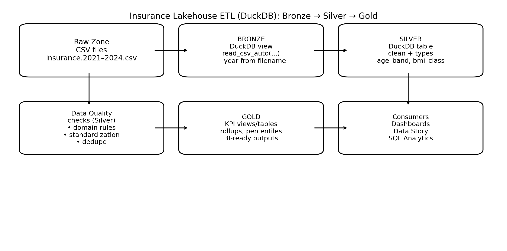

# Insurance Lakehouse: 4 Yearly Files (small warm-up)

Four raw files, one per year, land in [`data/bronze/`](data/bronze/):
`insurance.2021.csv` … `insurance.2024.csv` (1,300 members each; columns `age, gender, bmi, children, smoker, region, charges`).
The files contain **no year column**: the year comes from the **file name**, as it does in many real pipelines
(the partition key lives in the path, not in the data).

Used in [Lab 5.2](../../../labs/week_05_lab_02_student.md).

# Notebooks (open them from this folder)

| File | What it is |
|---|---|
| `01_EDA_Insurance_Dataset_DuckDB.py` | EDA across the 4 files with DuckDB ([notes](EDA_README.md)) |
| `02_DuckDB_Medallion_basic.py` | Minimal Bronze → Silver → Gold with views |
| `03_DuckDB_Medallion.py` | Fuller pipeline: quality rules, Silver tables, Gold KPIs |
| `04_DuckDB_Medallion.py` | Medallion demo with segments (smoker, age band, BMI class) and charts |
| `Insurance_Mini_Lakehouse_Reference.py` | Short reference: metadata discovery, year from file name, Silver/Gold |
| [`Insurance_Lakehouse_Data_Story.marp.md`](Insurance_Lakehouse_Data_Story.marp.md) | The data story as slides |
| [`Insurance_Lakehouse_SQL_Exercises_Student.marp.md`](Insurance_Lakehouse_SQL_Exercises_Student.marp.md) | 12 SQL exercises (homework) |

# What each layer does here

- **Bronze**: raw CSVs exactly as they arrived; `year` injected from the file name when reading.
- **Silver**: typed, standardized (lower/trim), validated (domain checks), with derived columns (`bmi_class`, `age_band`).
- **Gold**: business-ready KPIs (per year, per segment) for dashboards.
