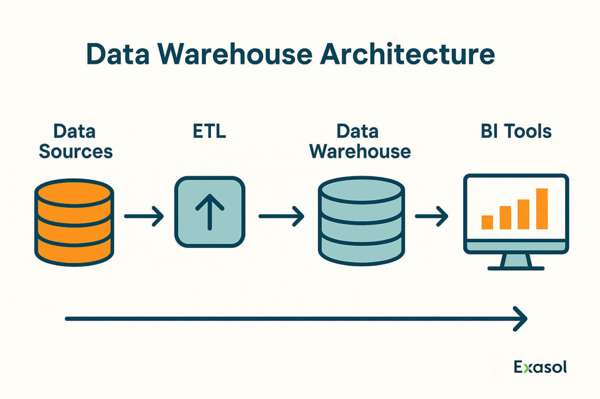
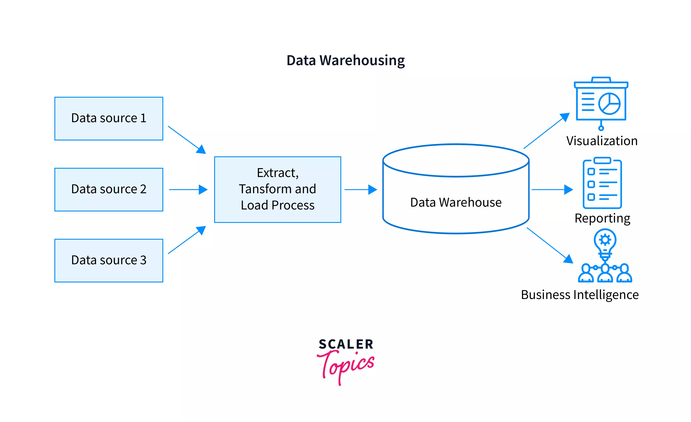
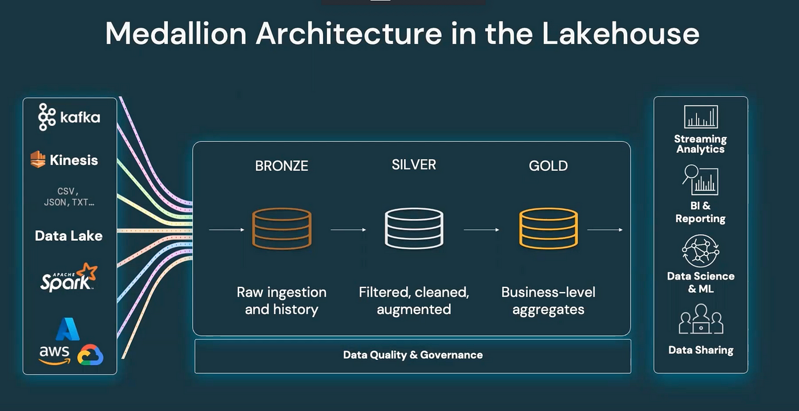
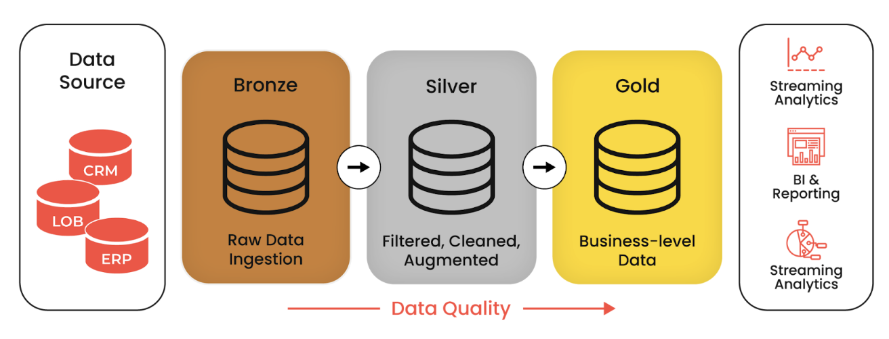
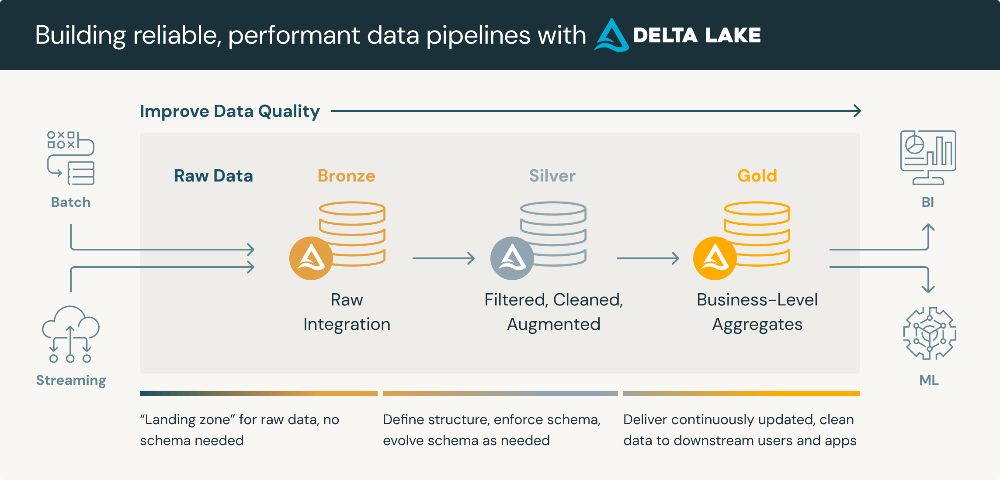

# Classic Data Warehousing <br> vs <br> Medallion Architecture

---

---

# 🔹 What Is a Data Warehouse?

---

## Definition

A Data Warehouse (DW) is a system designed to:

👉 collect, store, and analyze data  
👉 from multiple sources  
👉 for decision-making  

---

## Key Idea

#### ✅ Operational systems → run the business  

#### ✅ Data warehouse → understand the business  

---

## Characteristics

- integrated (multiple sources combined)  
- historical (stores past data)  
- structured (organized for analysis)  
- optimized for queries (not transactions)  

---

## Example

Sales, customers, and products data  
combined into one unified system  

---

## Insight

👉 A Data Warehouse answers:

**“What happened in the business?”**

---


# 🔹 Why Do We Need a Data Warehouse?


## Problem Without DW

Data is scattered:

- sales system  
- customer system  
- marketing system  

---

## Challenges

- inconsistent data  
- duplicate records  
- slow reporting  
- no single source of truth  

---

## What DW Solves

👉 integrates all data  
👉 cleans and standardizes  
👉 enables fast analytics  

---

## Business Value

- better decisions  
- consistent KPIs  
- historical analysis  
- trend identification  

---

## Example

### Instead of:
❌ 3 systems → 3 answers  

### With DW:
✅ 1 system → 1 trusted answer  

---

## Final Insight

👉 A Data Warehouse turns data into:

**trusted, decision-ready information**

---

# 🔹 Classic Data Warehousing (DW)

## Definition

Classic DW = centralized system for  
storing and analyzing structured data  

## Classic Data Warehousing Architecture





---

## Architecture Flow

Sources → ETL → Data Warehouse → Data Marts → BI / Reports

---

## Key Components

- ETL (Extract, Transform, Load)  
- Star Schema (fact + dimensions)  
- OLAP queries  

---

## Characteristics

- schema-first  
- batch processing  
- strong structure  

---

## Strengths

- consistent reporting  
- optimized for analytics  
- clear data model  

---

## Limitations

- slow to adapt  
- rigid pipelines  
- heavy ETL upfront  

---

## Insight

Designed for structured, stable analytics

---

# 🔹 Medallion Architecture

## Definition

Medallion = layered data architecture  

Bronze → Silver → Gold  

---








---

## Architecture Flow

Sources → Bronze → Silver → Gold → BI / ML

---

## Layers

Bronze: raw data  
Silver: cleaned + validated  
Gold: business-ready  

---

## Characteristics

- data-first  
- incremental pipelines  
- flexible  

---

## Strengths

- handles messy data  
- scalable  
- separates concerns  

---

## Insight

Designed for evolving data systems

---

# 🔹 Classic DW vs Medallion

## Visual Comparison

Classic DW:
Sources → ETL → Warehouse → BI  

Medallion:
Sources → Bronze → Silver → Gold → BI  

---

## Key Differences

| Aspect | Classic DW | Medallion |
|-------|-----------|-----------|
| Approach | Model first | Data first |
| Ingestion | Structured | Any |
| Transformation | Upfront ETL | Layered |
| Flexibility | Rigid | Flexible |
| Pipeline | Batch | Incremental |
| Data Quality | Early | Progressive |

---

## Key Insight

Classic DW = single refined layer  
Medallion = progressive refinement  

---

## Final Message

Both aim for trusted data  

Medallion makes the journey visible

## Question

👉 “If you were building a system today, which one would you choose—and why?”

---

# 🔹 KPIs: What the Warehouse Delivers

## What Is a KPI?

A **KPI (Key Performance Indicator)** is a number the business watches to judge how it is doing.

Data warehousing also has KPIs *about itself*: they measure the efficiency, accuracy, and value of the warehouse:

- **data quality**: accuracy, consistency
- **system performance**: latency, uptime
- **business value**: user adoption, report accuracy

---

## 🧠 The KPI Pattern

KPIs in a DW typically follow:

**AGGREGATE (fact) + GROUP BY (dimension)**

| KPI | Fact | Dimension |
|-----|------|-----------|
| Revenue | `SUM(sales_amount)` | time |
| Visits | `COUNT(*)` | year / month |
| Customers | `COUNT(DISTINCT customer_id)` | region |

## 🎓 Golden Takeaway

A KPI is just: **Aggregation + Business Meaning**

---

## 📊 1. Total Revenue

- **Definition:** total sales amount over a period
- **DW mapping:** `SUM(sales_amount)` from the fact table

```sql
SELECT SUM(sales_amount) AS total_revenue
FROM fact_sales;
```

---

## 📈 2. Revenue Growth Rate

- **Definition:** % change compared to the previous period

```sql
SELECT
  year,
  SUM(sales_amount) AS revenue,
  LAG(SUM(sales_amount)) OVER (ORDER BY year) AS prev_revenue,
  (SUM(sales_amount) - LAG(SUM(sales_amount)) OVER (ORDER BY year))
  / LAG(SUM(sales_amount)) OVER (ORDER BY year) AS growth_rate
FROM fact_sales
GROUP BY year;
```

---

## 🛒 3. Customer Count

- **Definition:** number of unique customers

```sql
SELECT COUNT(DISTINCT customer_id) AS total_customers
FROM fact_sales;
```

## 🔁 4. Customer Retention Rate

- **Definition:** customers who come back in the next period
- Conceptually: **returning customers / total customers**

---

## 📦 5. Total Orders

```sql
SELECT COUNT(*) AS total_orders
FROM fact_orders;
```

## 💵 6. Average Order Value (AOV)

- **Definition:** revenue per order

```sql
SELECT SUM(order_amount) / COUNT(*) AS avg_order_value
FROM fact_orders;
```

---

## 🌍 7. Dimensional KPIs (Slice & Dice): Revenue by Region

```sql
SELECT region,
       SUM(sales_amount) AS revenue
FROM fact_sales
GROUP BY region;
```

---

## 🏛️ KPIs on a Visits Log

The same pattern works on any event table. Example: a `gold.visits` table with one row per visit
(`visitor_name`, `meeting_loc`, `year`, `month`), like the White House visitor logs in week 5.

## 🗓️ 8. Monthly Visits

```sql
SELECT year, month,
       COUNT(*) AS visits
FROM gold.visits
GROUP BY year, month
ORDER BY year, month;
```

---

## 👥 9. Top Visitors

```sql
SELECT visitor_name,
       COUNT(*) AS visits
FROM gold.visits
GROUP BY visitor_name
ORDER BY visits DESC
LIMIT 10;
```

## 🏢 10. Visits by Location

```sql
SELECT meeting_loc,
       COUNT(*) AS visits
FROM gold.visits
GROUP BY meeting_loc
ORDER BY visits DESC;
```

---

## 🎯 11. Time-Based KPI: Visits Trend (very important)

```sql
SELECT year,
       COUNT(*) AS visits
FROM gold.visits
GROUP BY year
ORDER BY year;
```

👉 Every Gold table you build in weeks 8–10 exists to answer questions like these.
