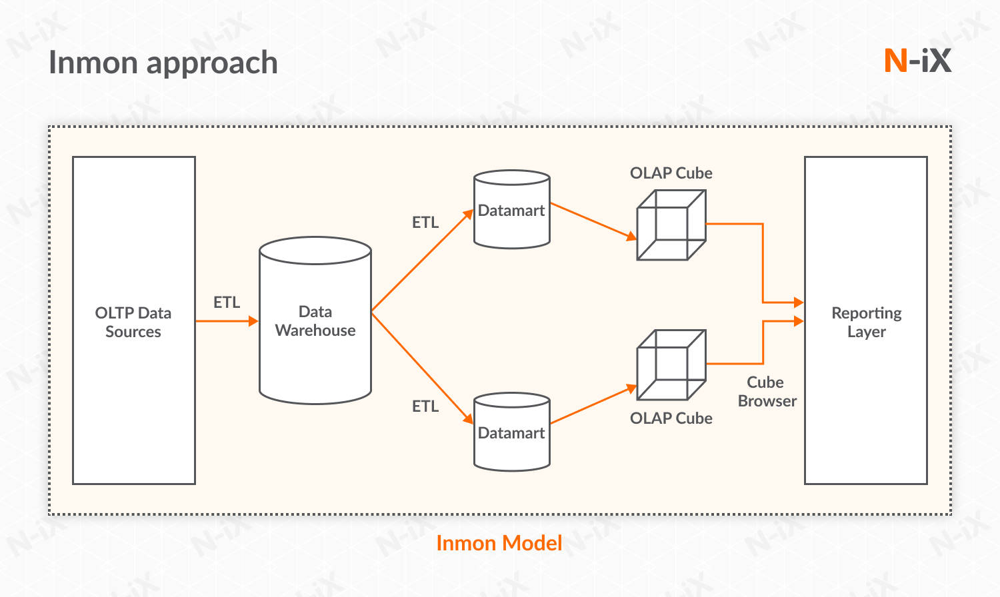

# Week 3
## Classic Data Warehousing: from an Operational Database to a Star Schema

One small coffee shop, start to finish: OLTP tables → grain → facts and dimensions → star schema → validation

---

# 🎯 Learning Objectives

By the end of this session you can:

1. explain why analysts do not query the **operational** (OLTP) database directly
2. compare the **Inmon** and **Kimball** ways to build a warehouse
3. name the **grain**, the **facts** (measures) and the **dimensions** of a business process
4. build a small **star schema** with **surrogate keys**, and **validate** it against the source

Today's example is a tiny coffee shop, built right inside the slides. **Lab 3.1** does the same steps on the book-seller data.

---

# 🧠 Two Kinds of Database, Two Kinds of Work

| | **OLTP** (operational) | **OLAP** (data warehouse) |
|---|---|---|
| Purpose | **run** the business: take an order now | **analyze** the business: revenue per month, per product |
| Typical query | one order, by its id | millions of rows, grouped and summed |
| Writes | many small inserts/updates per second | loaded in batches (nightly, hourly) |
| Design | **normalized** (3NF): no repeated data | **denormalized** (star schema): few joins |
| History | current state (a customer's **current** city) | history kept (where the customer lived **when** they bought) |
| Users | cashiers, apps | analysts, dashboards |

👉 Same data, different shape: the warehouse is **built from** the OLTP database by **ETL**.

---

# ☕ Our OLTP Database: a Coffee Shop

```sql
CREATE OR REPLACE TABLE customers AS
SELECT * FROM (VALUES (1, 'Ana', 'San Jose'), (2, 'Ben', 'Santa Clara'),
                      (3, 'Chen', 'San Jose'), (4, 'Dara', 'Palo Alto'))
     AS t(customer_id, name, city);

CREATE OR REPLACE TABLE products AS
SELECT * FROM (VALUES (10, 'Latte', 'Coffee', 4.50), (11, 'Espresso', 'Coffee', 3.00),
                      (12, 'Green Tea', 'Tea', 3.50), (13, 'Croissant', 'Bakery', 3.25),
                      (14, 'Muffin', 'Bakery', 2.75))
     AS t(product_id, name, category, price);

CREATE OR REPLACE TABLE orders AS
SELECT order_id, customer_id, order_ts::TIMESTAMP AS order_ts
FROM (VALUES (1001, 1, '2026-01-05 08:10'), (1002, 2, '2026-01-05 09:30'),
             (1003, 1, '2026-01-21 08:05'), (1004, 3, '2026-02-02 10:15'),
             (1005, 4, '2026-02-02 16:40'), (1006, 2, '2026-02-20 08:20'))
     AS t(order_id, customer_id, order_ts);

CREATE OR REPLACE TABLE order_lines AS
SELECT * FROM (VALUES (1001, 1, 10, 1, 4.50), (1001, 2, 13, 1, 3.25), (1002, 1, 11, 2, 3.00),
                      (1003, 1, 10, 1, 4.50), (1003, 2, 14, 2, 2.75), (1004, 1, 12, 1, 3.50),
                      (1004, 2, 13, 2, 3.25), (1005, 1, 10, 2, 4.50), (1006, 1, 11, 1, 3.00),
                      (1006, 2, 14, 1, 2.75))
     AS t(order_id, line_no, product_id, quantity, unit_price);
```

4 normalized tables: `customers`, `products`, `orders` (who, when), `order_lines` (what, how many, at which price).

---

# 🔍 The Operational Tables

```sql
SELECT 'customers' AS table_name, COUNT(*) AS n_rows FROM customers
UNION ALL SELECT 'products',    COUNT(*) FROM products
UNION ALL SELECT 'orders',      COUNT(*) FROM orders
UNION ALL SELECT 'order_lines', COUNT(*) FROM order_lines;
```

<!-- RESULT -->

| table_name  | n_rows |
|-------------|-------:|
| customers   |      4 |
| products    |      5 |
| orders      |      6 |
| order_lines |     10 |

*(4 rows)*

<!-- /RESULT -->

- **Normalized:** a product's category is stored **once** (in `products`), a customer's city **once** (in `customers`).
- `order_lines.unit_price` is the price **at the time of the sale**: if the Latte goes up to 4.75 tomorrow, yesterday's revenue must not change.

---

# 📊 An Analyst's Question on the OLTP Tables

**Question:** revenue per **month** and **product category**?

```sql
SELECT strftime(o.order_ts, '%Y-%m')          AS month,
       p.category,
       SUM(l.quantity * l.unit_price)         AS revenue
FROM order_lines AS l
JOIN orders      AS o ON o.order_id   = l.order_id
JOIN products    AS p ON p.product_id = l.product_id
GROUP BY ALL
ORDER BY month, revenue DESC;
```

<!-- RESULT -->

| month   | category | revenue |
|---------|----------|--------:|
| 2026-01 | Coffee   |   15.00 |
| 2026-01 | Bakery   |    8.75 |
| 2026-02 | Coffee   |   12.00 |
| 2026-02 | Bakery   |    9.25 |
| 2026-02 | Tea      |    3.50 |

*(5 rows)*

<!-- /RESULT -->

It works here. At **millions** of orders per day, the same query: needs joins across the live system, slows down the cashiers, sees only the **current**
city of each customer, and every analyst must remember how to compute revenue (`quantity * unit_price`).

---

# 🏛️ Two Classic Approaches: Inmon vs Kimball

| | **Bill Inmon** (top-down) | **Ralph Kimball** (bottom-up) |
|---|---|---|
| Start with | one enterprise-wide warehouse | one business process (e.g. sales) |
| Warehouse model | normalized (3NF) | dimensional (star schemas) |
| Data marts | built **from** the warehouse | together they **are** the warehouse |
| Integration via | the central model | conformed dimensions (shared `dim_date`, `dim_customer`, …) |
| Strength | consistency, one version of the truth | fast delivery, easy for analysts |
| Cost | slow, big design up front | needs discipline to stay consistent |

👉 In this course we build **Kimball-style** star schemas (weeks 3–4, and the Gold layer in week 8).

---

# 🏛️ Inmon Model in a Picture



- **Inmon:** OLTP sources → ETL → **enterprise DW (3NF)** → ETL → data marts → OLAP / reports
- **Kimball:** OLTP sources → ETL → **star schemas (data marts)**, linked by conformed dimensions

---

# 🧭 Kimball's 4 Design Steps (Applied to the Coffee Shop)

| Step | Question | Coffee shop |
|---|---|---|
| 1. Business process | which activity do we measure? | **selling** products |
| 2. **Grain** | what is **one row** of the fact table? | **one order line** (one product in one order) |
| 3. Dimensions | how do people describe a sale? | **when** (date), **what** (product), **who** (customer) |
| 4. Facts | what do we measure, as numbers? | `quantity`, `revenue` (= quantity × unit price) |

👉 Always in this order: the **grain first**. Every fact and every dimension must be true **at that grain**.

---

# 🧠 Why the Grain Comes First

| Grain | One fact row = | Can answer "revenue by **category**"? | Rows here |
|---|---|---|---|
| one order | a whole order (1–2 products) | ❌ an order mixes categories | 6 |
| **one order line** | **one product in one order** | ✅ | **10** |
| one day | everything sold that day | ❌ no product, no customer | 4 |

- Choose the **finest** grain the source offers: you can always add up later (week 4: roll-up), you can never split a total back apart.
- Mixed grains in one table (some rows = lines, some = orders) are the #1 cause of double counting.

---

# 📊 Facts and Dimensions

| | **Fact table** `fact_sales` | **Dimension tables** `dim_date`, `dim_product`, `dim_customer` |
|---|---|---|
| Holds | **measures**: `quantity`, `revenue` + a key to each dimension | **descriptions**: name, category, city, month, weekday … |
| Answers | "how much?", "how many?" | "by what?" (the `GROUP BY` and `WHERE` columns) |
| Size | **long**: one row per event (millions) | **short and wide**: one row per product / customer / day |
| Changes | new rows are **added** | rows are **updated** rarely (week 4: slowly changing dimensions) |

**Additive** measures can be summed in every direction (`quantity`, `revenue`). `unit_price` is **not** additive (summing prices means nothing): keep it, but report `SUM(revenue)`.

---

# 🔑 Build the Dimensions (with Surrogate Keys)

```sql
CREATE OR REPLACE TABLE dim_customer AS
SELECT ROW_NUMBER() OVER (ORDER BY customer_id) AS customer_key,   -- surrogate key
       customer_id,                                                -- natural (business) key
       name, city
FROM customers;

CREATE OR REPLACE TABLE dim_product AS
SELECT ROW_NUMBER() OVER (ORDER BY product_id) AS product_key,
       product_id, name AS product_name, category
FROM products;

SELECT * FROM dim_product;
```

<!-- RESULT -->

| product_key | product_id | product_name | category |
|------------:|-----------:|--------------|----------|
|           1 |         10 | Latte        | Coffee   |
|           2 |         11 | Espresso     | Coffee   |
|           3 |         12 | Green Tea    | Tea      |
|           4 |         13 | Croissant    | Bakery   |
|           5 |         14 | Muffin       | Bakery   |

*(5 rows)*

<!-- /RESULT -->

A **surrogate key** (`product_key`) is a number the warehouse makes up. The **natural key** (`product_id`) comes from the source; we keep it to look rows up.

---

# 📅 The Date Dimension

```sql
CREATE OR REPLACE TABLE dim_date AS
SELECT strftime(d, '%Y%m%d')::INTEGER AS date_key,     -- 20260105: readable, sortable
       d                              AS full_date,
       year(d)                        AS year,
       month(d)                       AS month,
       strftime(d, '%Y-%m')           AS year_month,
       dayname(d)                     AS weekday
FROM (SELECT DISTINCT order_ts::DATE AS d FROM orders);

SELECT * FROM dim_date ORDER BY date_key;
```

<!-- RESULT -->

| date_key | full_date  | year | month | year_month | weekday   |
|---------:|------------|-----:|------:|------------|-----------|
| 20260105 | 2026-01-05 | 2026 |     1 | 2026-01    | Monday    |
| 20260121 | 2026-01-21 | 2026 |     1 | 2026-01    | Wednesday |
| 20260202 | 2026-02-02 | 2026 |     2 | 2026-02    | Monday    |
| 20260220 | 2026-02-20 | 2026 |     2 | 2026-02    | Friday    |

*(4 rows)*

<!-- /RESULT -->

- The month, the weekday, … are computed **once** here, so every report uses the same definition.
- A real `dim_date` holds **every** day of the period (not only the days with sales), so "days with no sales" can be counted too.

---

# ⭐ Build the Fact Table

```sql
CREATE OR REPLACE TABLE fact_sales AS
SELECT l.order_id, l.line_no,                                  -- degenerate dimension (order number)
       strftime(o.order_ts, '%Y%m%d')::INTEGER AS date_key,
       p.product_key,
       c.customer_key,
       l.quantity,
       l.quantity * l.unit_price               AS revenue      -- computed once, here
FROM order_lines   AS l
JOIN orders        AS o ON o.order_id    = l.order_id
JOIN dim_product   AS p ON p.product_id  = l.product_id        -- natural key → surrogate key
JOIN dim_customer  AS c ON c.customer_id = o.customer_id;

SELECT * FROM fact_sales ORDER BY order_id, line_no LIMIT 5;
```

<!-- RESULT -->

| order_id | line_no | date_key | product_key | customer_key | quantity | revenue |
|---------:|--------:|---------:|------------:|-------------:|---------:|--------:|
|     1001 |       1 | 20260105 |           1 |            1 |        1 |    4.50 |
|     1001 |       2 | 20260105 |           4 |            1 |        1 |    3.25 |
|     1002 |       1 | 20260105 |           2 |            2 |        2 |    6.00 |
|     1003 |       1 | 20260121 |           1 |            1 |        1 |    4.50 |
|     1003 |       2 | 20260121 |           5 |            1 |        2 |    5.50 |

*(5 rows)*

<!-- /RESULT -->

Each fact row: **keys** to its dimensions + **measures**. No names, no categories, no cities: those live in the dimensions.

---

# ✅ Validate the Star Against the Source

```sql
SELECT (SELECT COUNT(*) FROM order_lines)                       AS source_lines,
       (SELECT COUNT(*) FROM fact_sales)                        AS fact_rows,
       (SELECT SUM(quantity * unit_price) FROM order_lines)     AS source_revenue,
       (SELECT SUM(revenue) FROM fact_sales)                    AS fact_revenue,
       (SELECT COUNT(*) FROM fact_sales
        WHERE product_key IS NULL OR customer_key IS NULL)      AS missing_keys;
```

<!-- RESULT -->

| source_lines | fact_rows | source_revenue | fact_revenue | missing_keys |
|-------------:|----------:|---------------:|-------------:|-------------:|
|           10 |        10 |          48.50 |        48.50 |            0 |

*(1 row)*

<!-- /RESULT -->

Rows in = rows out, total in = total out, and every fact row found its dimension rows. **Never skip this step**: an inner `JOIN` that
does not match silently **drops** fact rows (a product missing from `products` would vanish from revenue).

---

# 📊 The Same Question on the Star

```sql
SELECT d.year_month AS month,
       p.category,
       SUM(f.revenue) AS revenue
FROM fact_sales  AS f
JOIN dim_date    AS d ON d.date_key    = f.date_key
JOIN dim_product AS p ON p.product_key = f.product_key
GROUP BY ALL
ORDER BY month, revenue DESC;
```

<!-- RESULT -->

| month   | category | revenue |
|---------|----------|--------:|
| 2026-01 | Coffee   |   15.00 |
| 2026-01 | Bakery   |    8.75 |
| 2026-02 | Coffee   |   12.00 |
| 2026-02 | Bakery   |    9.25 |
| 2026-02 | Tea      |    3.50 |

*(5 rows)*

<!-- /RESULT -->

Same answer as on the OLTP tables, but: every join is **fact → dimension** (one hop), revenue is **already computed**, and `month` comes from `dim_date`.
Every star-schema query has this shape: `SUM(measure)` from the fact, `GROUP BY` dimension columns.

---

# 🔑 Why Surrogate Keys?

- **History** (week 4): if Ben moves from Santa Clara to San Jose, `dim_customer` can keep **two** rows for him (two `customer_key`s, one `customer_id`),
  so old sales stay in Santa Clara. With `customer_id` as the key, that is impossible.
- **Many sources:** two shops can both have a product `10`; the warehouse gives them different `product_key`s.
- **Stability:** the source may re-number or re-use its ids; the warehouse keys never change.
- **Exception:** `dim_date` often uses a "smart" key (`20260105`): a date never changes, and the key is readable.

---

# ⚖️ Normalized vs Denormalized

| | OLTP (normalized) | Star schema (denormalized) |
|---|---|---|
| `category` | in `products` only | copied into `dim_product` (could also hold supplier, brand …) |
| A category is renamed | update **1** row | update every product row of that category (rare, done by ETL) |
| Revenue by category | `order_lines` → `products` | `fact_sales` → `dim_product` (one hop) |
| Optimized for | correct, fast **writes** | simple, fast **reads** |

👉 Redundancy is a problem when **many users write**; in a warehouse **only ETL writes**, so we trade a little redundancy for simple queries.
More: [why warehouses denormalize](Normalization/Importance_of_Denormalization_in_Data_Warehousing.md).

---

# 🧰 Summary

| Concept | In one line | Coffee shop |
|---|---|---|
| OLTP vs OLAP | run the business vs analyze it | 4 normalized tables → 1 star |
| Grain | what one fact row is | one order line |
| Fact | measures + dimension keys | `fact_sales(quantity, revenue)` |
| Dimension | descriptive context | `dim_date`, `dim_product`, `dim_customer` |
| Surrogate key | warehouse-made key, keeps history | `product_key`, `customer_key` |
| Validation | rows, totals, missing keys | 10 = 10 lines, 48.50 = 48.50 |

👉 Now: **Lab 3.1** (30 minutes): the same steps on the book seller's 2 operational tables.
