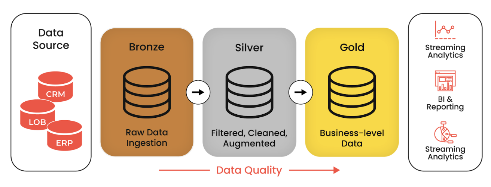

# 🟡 Medallion Architecture in a Nutshell

**The one-page reference for weeks 5–9.** Every notebook, lab and slide in this course uses these words with exactly these meanings.

#  🟫 Bronze → ⚪ Silver → 🟡 Gold

A **layered design** for a data warehouse or lakehouse: data moves from **as received** (Bronze) to **trusted** (Silver)
to **business-ready** (Gold), and every layer is **kept**. The name comes from Databricks; the idea works in any database (DuckDB included).

---

# The Three Layers

| | 🟫 **Bronze** | ⚪ **Silver** | 🟡 **Gold** |
|---|---|---|---|
| **Holds** | the data **exactly as received**, plus lineage columns (`_source_file`, `_ingested_at`) | one row per real event or entity: **typed**, **standardized**, **business rules applied** | tables shaped for **business questions** |
| **Typical tables** | `bronze.sales_raw` (every column as text) | `silver.sales` (valid + flagged rows), `silver.rejected` (with a reason) | a star schema (`fact_*`, `dim_*`) and KPI / summary tables |
| **Allowed changes** | **append only**: never fixed, never deleted | rebuilt from Bronze when a rule changes | rebuilt from Silver |
| **Never** | apply business rules, deduplicate, filter | lose a row without a count and a reason | clean data, or read from Bronze |
| **Answers** | "what did the source **send**?" | "what **really** happened?" | "what does the **business** need to know?" |

**Three** layers. BI dashboards, ML models and auditors are **consumers**: they read a layer, they are not one.

---

# Every Bronze Row Gets Exactly One Fate in Silver

| Fate | Meaning | Where | Example |
|---|---|---|---|
| ✅ **valid** | passes every rule | `silver.sales` | a normal sale |
| 🏷️ **flagged** | a real event with a special status: **kept**, marked | `silver.sales` + a flag column | missing `sale_id` = cancelled → `is_cancelled = true` |
| 🚫 **rejected** | breaks a rule and cannot be used: **quarantined** | `silver.rejected` + `reject_reason` | missing product, impossible date |
| ♊ **duplicate** | another copy of a row we already have (identical, or the same key) | removed, **counted** | the same sale sent twice |

A **fix** (e.g. a NULL discount set to 0.00 by a rule) is an action on a row that stays valid, not a fate.
Some pipelines keep flagged rows in a table of their own (the 18K example: `silver.cancelled_transactions`): the same fate, different storage. What matters is that the row is **kept** and **counted**.

### ⚖️ Reconcile after every load: **Bronze rows = valid + flagged + rejected + duplicates**

---

# The Words We Use

| Word | Means | Never means |
|---|---|---|
| **reject** / **quarantine** | move the row to `silver.rejected`, with the rule that failed | delete it |
| **flag** | keep the row, add a column that marks its status | filter it out |
| **fix** / **default** | change a value according to a written rule | guess |
| **deduplicate** | keep one copy (identical rows: any; same key: the most complete), count the others | `DISTINCT` on everything without checking |
| **lineage** | `_source_file`, `_ingested_at`: where and when a row arrived | business data |
| **replay** | rebuild Silver and Gold from Bronze after a rule changes | re-extract from the source |
| **grain** (Gold) | what one row of a fact table means (e.g. one sale) | "the level of detail, roughly" |

---

# Why It Matters

- **Audit:** "what did the source send?" Bronze still has it, with file and time.
- **Explain any number:** Gold → Silver (`silver.rejected` says why a row is missing) → Bronze (what really arrived).
- **Change a rule safely:** edit one Silver step and replay from Bronze; nothing has to be sent again.
- **One set of rules:** all cleaning happens once, in Silver, so every Gold table and every dashboard agrees.
- **Different users, different layers:** auditors read Bronze, data scientists Silver, dashboards Gold.

---

# Common Mistakes

| Mistake | Instead |
|---|---|
| fixing an obvious error **in Bronze** | write the fix as a Silver rule |
| `WHERE col IS NOT NULL` that silently drops rows | reject with a reason, or flag |
| deleting cancelled / returned sales | keep them, flagged |
| cleaning inside Gold or a dashboard | every rule in Silver, once |
| building Gold from Bronze | Gold reads only Silver |
| skipping the reconciliation | run it after every load; stop if it fails |

---

# Worked Examples (in This Order)

1. [10-rows case study](./case_study_10_rows): every kind of problem in 10 rows, traced through all three layers to a star schema. **Start here.**
2. [Session 1 slides](./slides_and_notebook/lecture_notes_01_medallion_architecture.md): the same 10 rows, one slide per step, with the reconciliation `10 = 3 + 1 + 5 + 1`.
3. **Lab 5.1:** the same pipeline on 1,400 messy sales ([`sales_1400_messy_records`](./sales_1400_messy_records): data + business rules).
4. Bigger: [`sales_1200_clean_records`](./sales_1200_clean_records) (clean) · [`sales_18K_messy_records`](./sales_18K_messy_records) (18,000 rows).
5. Session 2: the same layers as **files** (Parquet) in a lakehouse: [slides](./slides_and_notebook/lecture_notes_02_lakehouse_with_duckdb.md).
6. Weeks 6–9: the pizza shop, end to end (Bronze + Silver in weeks 6–7, Gold in week 8, incremental loads in week 9).
