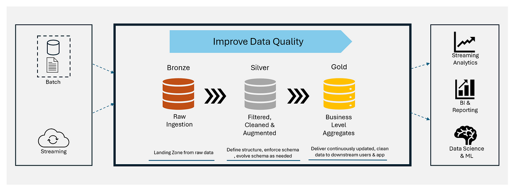

# Week 5
## Medallion Architecture: Bronze → Silver → Gold



One idea for the rest of the course: **keep every row, and know what happened to it.**

---

# 🧭 Where We Are

| Weeks | You learned | Today it becomes |
|---|---|---|
| 1–2 | SQL, cleaning functions, EDA | the **Silver** rules |
| 3 | ETL: profile, clean, reject, reconcile | the **Bronze → Silver** step, done in layers |
| 4 | star schema, OLAP | the **Gold** layer |

**What changes:** in week 3, ETL cleaned the data **on the way in**: the warehouse held only the result.
Medallion **stores every stage** as its own layer, so we can always see, explain and **replay** what happened.

---

# ❓ Why Keep the Raw Data?

A source sends the region three ways:

| region (as received) | charges |
|---|---:|
| `NE` | 1,000 |
| `north-east` | 1,200 |
| `northeast` | 1,500 |

After cleaning, all three are `northeast` (total 3,700), which is **right** for reports. But now:

- "How many rows did the source send as `NE`?" (to fix the source system)
- "The mapping rule was wrong: rebuild everything with the new rule."

Both need the data **as received**. If the pipeline kept only the cleaned rows, the answer is gone. Medallion keeps it: that is **Bronze**.

---

# 🥉🥈🥇 The Three Layers

| | 🟫 **Bronze** | ⚪ **Silver** | 🟡 **Gold** |
|---|---|---|---|
| Holds | the data **exactly as received** + lineage (`_source_file`, `_ingested_at`) | one row per real event, **typed**, **standardized**, **business rules applied** | tables shaped for **business questions** |
| Typical tables | `bronze.sales_raw` (all text) | `silver.sales` (valid + flagged), `silver.rejected` (with reason) | star schema (`fact_sales`, `dim_*`), KPI tables |
| Changes allowed | **append only**: never fixed, never deleted | rebuilt from Bronze whenever a rule changes | rebuilt from Silver |
| Answers | "what did the source **send**?" | "what **really** happened?" | "what does the **business** need to know?" |
| Read by | auditors, data engineers | data scientists, analysts | dashboards, executives |

**Three** layers. BI, ML and audit are **consumers** that read the layers, not layers of their own.

---

# 🧩 Every Row Gets Exactly One Fate in Silver

| Fate | Meaning | Where it goes | Example rule |
|---|---|---|---|
| ✅ **valid** | passes every rule | `silver.sales` | — |
| 🏷️ **flagged** | a real event with a special status | `silver.sales`, with a flag column | missing `sale_id` = cancelled → `is_cancelled = true` |
| 🚫 **rejected** | breaks a rule, cannot be used | `silver.rejected` **+ `reject_reason`** (quarantine) | missing product |
| ♊ **duplicate** | another copy of a row we already have (identical, or the same key) | removed, but **counted** | the same sale sent twice |

Fixing a value (`NULL` discount → 0) is not a fate: the row stays valid, with the value fixed by a rule.

### 👉 Reconcile: **Bronze rows = valid + flagged + rejected + duplicates**

Nothing disappears without a count and a reason. That is the difference from "just cleaning".

---

# 🧪 Our Data: 10 Sales and 8 Business Rules

The [10-row case study](../case_study_10_rows/): every kind of problem in 10 rows.

| # | Rule | Fate |
|---|---|---|
| 1 | missing `sale_id` → the sale was **cancelled** | flagged (`is_cancelled`) |
| 2 | missing `product` | rejected |
| 3 | missing / empty `customer_name` | rejected |
| 4 | missing or negative `discount` → 0.00 | fixed (row stays valid) |
| 5–6 | `sale_date` must be `MM/DD/YYYY` or `YYYY-MM-DD` and a real date | rejected |
| 7 | exact duplicate rows | duplicate (removed, counted) |
| 8 | `final_sale_price = quantity * unit_price - discount` | computed |

The rules come from the **business**, in writing. Silver turns each one into SQL.

---

# 🟫 Bronze: Land It As Received

```sql
CREATE SCHEMA IF NOT EXISTS bronze;
CREATE SCHEMA IF NOT EXISTS silver;
CREATE SCHEMA IF NOT EXISTS gold;

CREATE OR REPLACE TABLE bronze.sales_raw AS
SELECT *,
       'sales_data_10_rows.csv' AS _source_file,    -- lineage: where from?
       current_timestamp        AS _ingested_at     -- lineage: when?
FROM read_csv('../case_study_10_rows/sales_data_10_rows.csv', all_varchar = true);

SELECT sale_id, sale_type, product, customer_name, quantity, unit_price, discount, sale_date
FROM bronze.sales_raw;
```

<!-- RESULT -->

| sale_id | sale_type | product  | customer_name | quantity | unit_price | discount | sale_date  |
|---------|-----------|----------|---------------|----------|------------|----------|------------|
| 1001    | ON-LINE   | TV       | John Smith    | 1        | 900        | 50       | 12/31/2025 |
| 1002    | IN-STORE  | IPHONE   | Mary Jones    | 2        | 1100       | -20      | 2025-12-30 |
| NULL    | ON-LINE   | WATCH    | Bob Lee       | 3        | 200        | 10       | 12/29/2025 |
| 1004    | ON-LINE   | NULL     | Alice Brown   | 1        | 700        | 0        | 12/28/2025 |
| 1005    | IN-STORE  | EBIKE    | NULL          | 1        | 2200       | 100      | 2025-12-27 |
| 1006    | ON-LINE   | COMPUTER | David Kim     | 1        | 1500       | NULL     | 31-12-25   |
| 1007    | IN-STORE  | IPAD     | Susan Clark   | 2        | 700        | 20       | NULL       |
| 1001    | ON-LINE   | TV       | John Smith    | 1        | 900        | 50       | 12/31/2025 |
| 1009    | ON-LINE   | WATCH    | Rita Patel    | 4        | 250        | 30       | 2025-12-26 |
| 1010    | IN-STORE  | COMPUTER | Omar Khan     | 1        | 1400       | 0        | 2025-02-29 |

*(10 rows)*

<!-- /RESULT -->

`all_varchar = true`: nothing is converted, so nothing can fail or be changed on the way in. The leading `_` marks technical (lineage) columns.

---

# 🟫 The Bronze Rules

- **Never fix Bronze**, even when the error is obvious (`-20` discount, `2025-02-29`). Fixes belong to Silver, where they are written down as rules.
- **Append only:** next month's file is **added** (with its own `_source_file`), old rows are never updated or deleted.
- **No business rules**, no filters, no deduplication. Profiling Bronze is fine; changing it is not.

Why so strict? Because rules **change**. When the business changes a rule, we rebuild Silver and Gold **from Bronze**,
without asking the source to send the data again (slide "A Rule Changes" below).

---

# ⚪ Silver Step 1: Remove Exact Duplicates (Rule 7)

```sql
CREATE OR REPLACE TABLE silver.step1_dedup AS
SELECT DISTINCT * EXCLUDE (_ingested_at)
FROM bronze.sales_raw;

SELECT (SELECT COUNT(*) FROM bronze.sales_raw)   AS bronze_rows,
       (SELECT COUNT(*) FROM silver.step1_dedup) AS after_dedup;
```

<!-- RESULT -->

| bronze_rows | after_dedup |
|------------:|------------:|
|          10 |           9 |

*(1 row)*

<!-- /RESULT -->

Sale 1001 (TV, John Smith) arrived twice, identical in every column: one copy is removed, and the **1** is counted for the reconciliation.

---

# ⚪ Silver Step 2: Types, Standard Values, Fixes (Rules 4–6)

```sql
CREATE OR REPLACE TABLE silver.step2_typed AS
SELECT TRY_CAST(sale_id AS INTEGER)                         AS sale_id,
       UPPER(TRIM(sale_type))                               AS sale_type,
       UPPER(TRIM(product))                                 AS product,
       TRIM(customer_name)                                  AS customer_name,
       LOWER(TRIM(customer_email))                          AS customer_email,
       TRY_CAST(quantity AS INTEGER)                        AS quantity,
       TRY_CAST(unit_price AS DECIMAL(10, 2))               AS unit_price,
       CASE WHEN TRY_CAST(discount AS DECIMAL(10, 2)) > 0
            THEN TRY_CAST(discount AS DECIMAL(10, 2))
            ELSE 0.00 END                                   AS discount,       -- rule 4
       CASE WHEN sale_date LIKE '__/__/____' THEN try_strptime(sale_date, '%m/%d/%Y')
            WHEN sale_date LIKE '____-__-__' THEN try_strptime(sale_date, '%Y-%m-%d')
       END::DATE                                            AS sale_date,      -- rules 5-6
       sale_date                                            AS sale_date_raw,  -- kept for the reject reason
       _source_file
FROM silver.step1_dedup;

SELECT sale_id, product, customer_name, discount, sale_date_raw, sale_date
FROM silver.step2_typed ORDER BY sale_date_raw;
```

<!-- RESULT -->

| sale_id | product  | customer_name | discount | sale_date_raw | sale_date  |
|--------:|----------|---------------|---------:|---------------|------------|
|    1004 | NULL     | Alice Brown   |     0.00 | 12/28/2025    | 2025-12-28 |
|    NULL | WATCH    | Bob Lee       |    10.00 | 12/29/2025    | 2025-12-29 |
|    1001 | TV       | John Smith    |    50.00 | 12/31/2025    | 2025-12-31 |
|    1010 | COMPUTER | Omar Khan     |     0.00 | 2025-02-29    | NULL       |
|    1009 | WATCH    | Rita Patel    |    30.00 | 2025-12-26    | 2025-12-26 |
|    1005 | EBIKE    | NULL          |   100.00 | 2025-12-27    | 2025-12-27 |
|    1002 | IPHONE   | Mary Jones    |     0.00 | 2025-12-30    | 2025-12-30 |
|    1006 | COMPUTER | David Kim     |     0.00 | 31-12-25      | NULL       |
|    1007 | IPAD     | Susan Clark   |    20.00 | NULL          | NULL       |

*(9 rows)*

<!-- /RESULT -->

- `try_strptime` returns NULL for `2025-02-29` (not a real date) and for a missing date: the next step rejects them.
- ⚠️ **Check the shape first** (`LIKE '____-__-__'`): on its own, `try_strptime('31-12-25', '%Y-%m-%d')` does **not** fail, it reads year **31** (0031-12-25).

---

# ⚪ Silver Step 3: Quarantine the Broken Rows (Rules 2, 3, 5–6)

```sql
CREATE OR REPLACE TABLE silver.rejected AS
SELECT *,
       CASE WHEN product IS NULL       THEN 'R2 missing product'
            WHEN customer_name IS NULL THEN 'R3 missing customer name'
            ELSE 'R5-6 missing or invalid date'
       END AS reject_reason
FROM silver.step2_typed
WHERE product IS NULL OR customer_name IS NULL OR sale_date IS NULL;

SELECT sale_id, product, customer_name, sale_date_raw, reject_reason
FROM silver.rejected ORDER BY sale_id;
```

<!-- RESULT -->

| sale_id | product  | customer_name | sale_date_raw | reject_reason                |
|--------:|----------|---------------|---------------|------------------------------|
|    1004 | NULL     | Alice Brown   | 12/28/2025    | R2 missing product           |
|    1005 | EBIKE    | NULL          | 2025-12-27    | R3 missing customer name     |
|    1006 | COMPUTER | David Kim     | 31-12-25      | R5-6 missing or invalid date |
|    1007 | IPAD     | Susan Clark   | NULL          | R5-6 missing or invalid date |
|    1010 | COMPUTER | Omar Khan     | 2025-02-29    | R5-6 missing or invalid date |

*(5 rows)*

<!-- /RESULT -->

**Rejected ≠ deleted.** Each row is kept with its reason: someone can fix it at the source, and we can always explain where it went.

---

# ⚪ Silver Step 4: The Trusted Table (Rules 1 and 8)

```sql
CREATE OR REPLACE TABLE silver.sales AS
SELECT * EXCLUDE (sale_date_raw),
       sale_id IS NULL                       AS is_cancelled,       -- rule 1: keep and flag
       quantity * unit_price - discount      AS final_sale_price    -- rule 8
FROM silver.step2_typed
WHERE NOT (product IS NULL OR customer_name IS NULL OR sale_date IS NULL);   -- exactly the rows not rejected

SELECT sale_id, product, quantity, unit_price, discount, final_sale_price, is_cancelled
FROM silver.sales ORDER BY sale_id NULLS LAST;
```

<!-- RESULT -->

| sale_id | product | quantity | unit_price | discount | final_sale_price | is_cancelled |
|--------:|---------|---------:|-----------:|---------:|-----------------:|--------------|
|    1001 | TV      |        1 |     900.00 |    50.00 |           850.00 | false        |
|    1002 | IPHONE  |        2 |    1100.00 |     0.00 |          2200.00 | false        |
|    1009 | WATCH   |        4 |     250.00 |    30.00 |           970.00 | false        |
|    NULL | WATCH   |        3 |     200.00 |    10.00 |           590.00 | true         |

*(4 rows)*

<!-- /RESULT -->

The cancelled watch sale is **flagged, not removed**: it is a real event ("how many sales are cancelled, and for which products?").
The `-20` discount of sale 1002 became 0.00 (rule 4).

---

# ⚖️ Reconcile: Every Row Accounted For

```sql
SELECT (SELECT COUNT(*) FROM bronze.sales_raw)                       AS bronze_rows,
       (SELECT COUNT(*) FROM silver.sales WHERE NOT is_cancelled)    AS valid,
       (SELECT COUNT(*) FROM silver.sales WHERE is_cancelled)        AS flagged_cancelled,
       (SELECT COUNT(*) FROM silver.rejected)                        AS rejected,
       (SELECT COUNT(*) FROM bronze.sales_raw)
         - (SELECT COUNT(*) FROM silver.step1_dedup)                 AS duplicates;
```

<!-- RESULT -->

| bronze_rows | valid | flagged_cancelled | rejected | duplicates |
|------------:|------:|------------------:|---------:|-----------:|
|          10 |     3 |                 1 |        5 |          1 |

*(1 row)*

<!-- /RESULT -->

### **10 = 3 valid + 1 flagged + 5 rejected + 1 duplicate** ✅

Run this after **every** load. If the equation fails, a rule lost rows silently: stop and find them before anyone uses Gold.

---

# 🟡 Gold: a Star Schema from Silver

```sql
CREATE OR REPLACE TABLE gold.dim_product AS
SELECT ROW_NUMBER() OVER (ORDER BY product) AS product_key, product
FROM (SELECT DISTINCT product FROM silver.sales);

CREATE OR REPLACE TABLE gold.fact_sales AS
SELECT s.sale_id,
       strftime(s.sale_date, '%Y%m%d')::INTEGER AS date_key,
       p.product_key,
       s.quantity, s.discount, s.final_sale_price
FROM silver.sales AS s
JOIN gold.dim_product AS p USING (product)
WHERE NOT s.is_cancelled;                           -- Gold uses the flag explicitly

SELECT * FROM gold.fact_sales ORDER BY sale_id;
```

<!-- RESULT -->

| sale_id | date_key | product_key | quantity | discount | final_sale_price |
|--------:|---------:|------------:|---------:|---------:|-----------------:|
|    1001 | 20251231 |           2 |        1 |    50.00 |           850.00 |
|    1002 | 20251230 |           1 |        2 |     0.00 |          2200.00 |
|    1009 | 20251226 |           3 |        4 |    30.00 |           970.00 |

*(3 rows)*

<!-- /RESULT -->

Gold is built **only from Silver** and contains **no cleaning logic**. Grain of `fact_sales`: one sale. The case study adds `dim_customer` and `dim_date`.

---

# 🟡 Gold: Business Tables

```sql
CREATE OR REPLACE TABLE gold.sales_by_product AS
SELECT product,
       COUNT(*) FILTER (WHERE NOT is_cancelled)                  AS sales,
       SUM(final_sale_price) FILTER (WHERE NOT is_cancelled)     AS revenue,
       COUNT(*) FILTER (WHERE is_cancelled)                      AS cancelled,
       COALESCE(SUM(final_sale_price) FILTER (WHERE is_cancelled), 0) AS revenue_lost
FROM silver.sales
GROUP BY product
ORDER BY product;

SELECT * FROM gold.sales_by_product;
```

<!-- RESULT -->

| product | sales | revenue | cancelled | revenue_lost |
|---------|------:|--------:|----------:|-------------:|
| IPHONE  |     1 | 2200.00 |         0 |         0.00 |
| TV      |     1 |  850.00 |         0 |         0.00 |
| WATCH   |     1 |  970.00 |         1 |       590.00 |

*(3 rows)*

<!-- /RESULT -->

Gold holds the **star schema** (detail, for any question) **and** ready-made tables like this one (one business question, fast).
Both are Gold: "Gold" means *shaped for the business*, not "always aggregated".

---

# 🔍 Debugging Backward: Gold → Silver → Bronze

**A manager asks:** "We sold an e-bike on Dec 27. Why is EBIKE not in the revenue report?"

```sql
SELECT r.product, r.reject_reason, r._source_file, b.customer_name AS name_as_received, b.sale_date
FROM silver.rejected AS r
JOIN bronze.sales_raw AS b ON b.sale_id = r.sale_id::VARCHAR
WHERE r.product = 'EBIKE';
```

<!-- RESULT -->

| product | reject_reason            | _source_file           | name_as_received | sale_date  |
|---------|--------------------------|------------------------|------------------|------------|
| EBIKE   | R3 missing customer name | sales_data_10_rows.csv | NULL             | 2025-12-27 |

*(1 row)*

<!-- /RESULT -->

**Answer in one query:** Silver rejected it (rule 3, no customer name), and Bronze shows the source really sent it without a name, in
`sales_data_10_rows.csv`. Fix it at the source, or change the rule: the data to replay is still in Bronze.

---

# 🔁 A Rule Changes: Replay from Bronze

The business learns that `31-12-25` (DD-MM-YY) comes from a European store and is **valid**. New rule 5:

```sql
WITH parsed AS (
  SELECT CASE WHEN sale_date LIKE '__/__/____' THEN try_strptime(sale_date, '%m/%d/%Y')
              WHEN sale_date LIKE '____-__-__' THEN try_strptime(sale_date, '%Y-%m-%d') END AS old_rule,
         CASE WHEN sale_date LIKE '__/__/____' THEN try_strptime(sale_date, '%m/%d/%Y')
              WHEN sale_date LIKE '____-__-__' THEN try_strptime(sale_date, '%Y-%m-%d')
              WHEN sale_date LIKE '__-__-__'   THEN try_strptime(sale_date, '%d-%m-%y') END AS new_rule  -- one new line
  FROM silver.step1_dedup
)
SELECT COUNT(*) FILTER (WHERE old_rule IS NULL) AS bad_dates_old_rule,
       COUNT(*) FILTER (WHERE new_rule IS NULL) AS bad_dates_new_rule
FROM parsed;
```

<!-- RESULT -->

| bad_dates_old_rule | bad_dates_new_rule |
|-------------------:|-------------------:|
|                  3 |                  2 |

*(1 row)*

<!-- /RESULT -->

Change **one line** in Silver step 2, re-run Silver and Gold **from Bronze**: sale 1006 (COMPUTER, 1,500) moves from `silver.rejected` to `silver.sales`.
No re-extraction, no lost history: this is why Bronze is never fixed.

---

# 🧠 Who Uses Which Layer?

| Question | Layer |
|---|---|
| "What exactly did the source send on Dec 31?" | Bronze |
| "Where do we enforce the business rules?" | Silver |
| "Which rows did we reject, and why?" | Silver (`silver.rejected`) |
| "Train a model on clean, detailed sales" | Silver (mostly) |
| "Revenue by product for the CFO dashboard" | Gold |
| "Why did this dashboard number change?" | Gold → Silver → Bronze, backward |

---

# ⚠️ Common Mistakes

| Mistake | What goes wrong | Instead |
|---|---|---|
| fixing errors **in Bronze** | the original is lost; no replay, no audit | fix in Silver, as a written rule |
| `WHERE … IS NOT NULL` that **silently drops** rows | the reconciliation fails; nobody knows why | quarantine with a reason, or flag |
| removing **cancelled** sales | "how many were cancelled?" cannot be answered | keep and flag (`is_cancelled`) |
| cleaning logic in **Gold** or in the dashboard | every report cleans differently | all rules in Silver, once |
| Gold built from **Bronze** | duplicates and broken rows reach the CFO | Gold reads only Silver |
| forgetting the flag in Gold | revenue includes cancelled sales | `WHERE NOT is_cancelled` |

---

# ⚖️ Classic ETL vs Medallion

| | Classic ETL (week 3) | Medallion |
|---|---|---|
| Raw data | usually not kept after the load | **Bronze**, kept forever (append only) |
| Rules | inside the ETL program | **Silver**, one written rule → one SQL step |
| Bad rows | often dropped, or a separate error log | quarantined with a reason, **counted** |
| A rule changes | re-extract from the source | **replay** Silver and Gold from Bronze |
| Proof | row counts, if someone remembers | **reconcile** after every load |
| Result | a star schema | a star schema **and** a trail back to every source row |

The star schema does not change: Medallion changes **how we get there**, and what we keep on the way.

---

# ✅ Summary

- **Bronze** = as received + lineage; never fixed.
- **Silver** = rules applied; every row is **valid**, **flagged**, **rejected** (with a reason) or a **duplicate** (counted).
- **Gold** = shaped for the business: star schema + business tables, built only from Silver.
- **Reconcile:** Bronze rows = valid + flagged + rejected + duplicates (here **10 = 3 + 1 + 5 + 1**).

👉 Now: **Lab 5.1** (30 minutes): the same pipeline on **1,400** messy sales.
One page to keep: [Medallion in a nutshell](../Medallion_Architecture_in_a_Nutshell.md).
